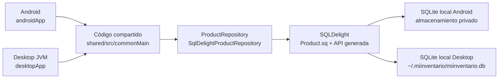

# MiInventario

**Aplicación multiplataforma para organizar productos de aseo y cocina del hogar.** Permite registrar cantidades disponibles y un mínimo de reposición. Está desarrollada con Kotlin Multiplatform, Compose Multiplatform y SQLDelight, con SQLite local para Android y Desktop JVM. Funciona sin conexión a internet durante su uso: no tiene servidor, autenticación ni sincronización entre dispositivos.

> **Estado del código:** RF1–RF7 están implementados para Android y Desktop mediante la interfaz compartida.

## Inicio rápido

Desde la raíz del repositorio, con JDK y Android SDK configurados:

```bash
./scripts/dev.sh
```

El menú permite ejecutar pruebas, verificar las compilaciones, generar el APK, iniciar Desktop o instalar el APK en un dispositivo Android. También se pueden usar directamente las tareas Gradle de la sección [Ejecución y pruebas](#ejecución-y-pruebas). La primera compilación puede necesitar internet para descargar dependencias; la aplicación no lo necesita para guardar productos.

## Tecnologías y módulos

- **Kotlin Multiplatform (KMP):** comparte modelo, validaciones, acceso a datos e interfaz.
- **Compose Multiplatform / Material 3:** interfaz común para Android y Desktop.
- **SQLDelight 2.3.2 y SQLite:** generación de API Kotlin desde SQL y almacenamiento local.
- **Gradle con Kotlin DSL y Gradle Wrapper:** configuración y compilación reproducible.
- **Git y GitHub:** colaboración mediante ramas y Pull Requests.

Las versiones exactas están en `gradle/libs.versions.toml` y `gradle/wrapper/gradle-wrapper.properties`. El proyecto configura una toolchain Java 21 en `gradle/gradle-daemon-jvm.properties`. No es necesario instalar Gradle globalmente ni cambiar las versiones por cuenta propia.

### Estructura real

```text
MiInventario/
├── androidApp/
│   └── src/main/kotlin/co/edu/poli/miinventario/MainActivity.kt
├── desktopApp/
│   └── src/main/kotlin/co/edu/poli/miinventario/main.kt
├── shared/
│   └── src/
│       ├── commonMain/
│       │   ├── kotlin/co/edu/poli/miinventario/
│       │   │   ├── App.kt
│       │   │   ├── product/
│       │   │   │   ├── Product.kt
│       │   │   │   ├── ProductRepository.kt
│       │   │   │   ├── ProductValidator.kt
│       │   │   │   ├── ProductFilters.kt
│       │   │   │   ├── ProductReplenishment.kt
│       │   │   │   ├── ProductWriteService.kt
│       │   │   │   └── ProductQuantity.kt
│       │   │   ├── data/                # SqlDelightProductRepository
│       │   │   └── ui/
│       │   │       ├── screens/
│       │   │       │   ├── HomeScreen.kt             # Inicio y Reposición
│       │   │       │   ├── ProductDetailScreen.kt
│       │   │       │   └── RegisterProductScreen.kt  # Registro y Edición
│       │   │       ├── state/           # ProductListState, RegisterProductState
│       │   │       └── theme/           # colores y tema Material 3
│       │   └── sqldelight/co/edu/poli/miinventario/database/Product.sq
│       ├── androidMain/kotlin/co/edu/poli/miinventario/data/
│       │   └── AndroidDatabaseFactory.kt
│       ├── jvmMain/kotlin/co/edu/poli/miinventario/data/
│       │   └── DesktopDatabaseFactory.kt
│       ├── commonTest/                  # validación, filtros y reposición
│       ├── jvmTest/                     # carga, formato, escritura, eliminación
│       │                                # y actualización de cantidades (SQLite en memoria)
│       └── androidHostTest/             # prueba host Android básica
├── scripts/dev.sh
├── gradle/libs.versions.toml
├── gradlew
├── gradlew.bat
└── README.md
```

- `androidApp` configura el APK. `MainActivity` crea el repositorio con la fábrica Android y llama a `App(repository)`.
- `desktopApp` contiene la ventana JVM. Su función `main` crea el repositorio con la fábrica Desktop y llama a la misma interfaz `App(repository)`.
- `shared/src/commonMain` contiene el modelo `Product`, sus reglas, la interfaz `ProductRepository`, su implementación SQLDelight y las pantallas Compose.
- `shared/src/androidMain` y `shared/src/jvmMain` solo contienen la creación de la base según la plataforma.
- `Product.sq` define la tabla y las consultas; Gradle/SQLDelight generan la API Kotlin durante la compilación.

Esta es una **separación práctica de responsabilidades**, no una implementación completa de Clean Architecture, MVVM o DDD. `App.kt` conecta las vistas mediante estado Compose y callbacks; las pantallas no ejecutan SQL directamente. El diagrama siguiente sigue siendo válido: las nuevas vistas y reglas pertenecen a `shared` y usan el mismo repositorio.

### Flujo de componentes



Las dos bases son independientes. No existe sincronización Android–Desktop.

## Datos y persistencia

`Product.sq` define la tabla `product`: UUID de texto como clave primaria, nombre, categoría, cantidad, unidad y mínimo. SQLDelight genera `InventoryDatabase` y `productQueries`; no se deben añadir a Git los archivos generados dentro de `build/`. La categoría y la unidad se guardan por el nombre de sus enumeraciones. `selectAllProducts` ordena por nombre.

| Operación de `ProductRepository` | Comportamiento actual |
|---|---|
| `save(product)` | Inserta un producto con su UUID. |
| `getAll()` | Consulta y convierte todas las filas a `Product`. |
| `update(product)` | Actualiza los datos de un UUID existente. |
| `deleteById(id)` | Elimina por UUID; devuelve `false` si no existe. |
| `updateQuantity(id, quantity)` | Actualiza solo `quantity`; devuelve `false` si no existe. |

`App.kt` ejecuta las operaciones de almacenamiento en `Dispatchers.IO` mediante el repositorio y los servicios de escritura/cantidad. `ProductWriteService` comprueba duplicados antes de registrar o editar: compara **nombre sin espacios externos, ignorando mayúsculas**, dentro de la **misma categoría**. En edición excluye el UUID propio y permite actualizar otros campos de duplicados históricos si nombre y categoría no cambian; no borra ni fusiona esos registros. Esta comprobación previa **no sustituye una restricción `UNIQUE` en SQLite ante escrituras simultáneas**. La tabla no impone unicidad por nombre y categoría.

En Android, `AndroidDatabaseFactory` usa `AndroidSqliteDriver`, el esquema generado y el `Context` de la aplicación para crear o abrir `miinventario.db` en el almacenamiento privado de esa aplicación. En Desktop, `DesktopDatabaseFactory` crea `~/.miinventario/` si hace falta y abre `~/.miinventario/miinventario.db` mediante el driver SQLite para JVM.

**Versión del esquema:** en Desktop se lee `PRAGMA user_version`. Si vale `0`, se crea el esquema y se escribe la versión generada por SQLDelight; si coincide, se abre la base; si es distinta, se informa un error. En Android la apertura/creación se delega al driver con `InventoryDatabase.Schema`. No hay archivos de migración `.sqm` ni un sistema completo de migraciones definido todavía: un cambio futuro de esquema requiere planificar cómo conservar las bases existentes.

## Requerimientos funcionales

| Código | Alcance | Estado actual |
|---|---|---|
| **RF1** | Registrar nombre, categoría, cantidad, unidad y mínimo. | **Implementado.** Valida, guarda, confirma y limpia el formulario tras guardar. |
| **RF2** | Consultar y listar productos. | **Implementado.** Inicio carga `getAll()` y muestra estados de carga, vacío y error con reintento. |
| **RF3** | Filtrar por Todos, Aseo o Cocina. | **Implementado.** Filtra en memoria y muestra contadores por categoría. |
| **RF4** | Editar un producto. | **Implementado.** Precarga datos y actualiza el UUID original, con validación y confirmación. |
| **RF5** | Eliminar con confirmación. | **Implementado.** Detalle solicita confirmación y elimina solo el UUID seleccionado. |
| **RF6** | Actualizar cantidad disponible. | **Implementado.** Detalle propone pasos de 1 `und` o 0,5 `kg`/`lb`/`L`; guarda solo la cantidad al confirmar. |
| **RF7** | Consultar productos por reponer. | **Implementado.** Usa `quantity <= minimumQuantity`; muestra aviso, etiquetas, detalle y vista específica. |

### Navegación actual

- **Inicio → Registro:** botón `+`; al volver, Inicio recarga la lista.
- **Inicio → Detalle:** seleccionar una tarjeta; desde Detalle se puede **Editar**, actualizar cantidad o **Eliminar** tras confirmar. Al regresar, se recarga Inicio.
- **Inicio → Productos por reponer:** acción **Ver** del aviso; la vista reutiliza las tarjetas y abre **Detalle**. Al cerrar Detalle se regresa a la vista de reposición; desde ella se vuelve a Inicio.
- **Detalle → Edición:** al salir del formulario se vuelve al inventario o a la vista de reposición desde la que se abrió Detalle. El filtro de categoría seleccionado en Inicio se conserva en el estado de `App.kt`.

`ProductValidator` rechaza nombre en blanco, cantidades negativas o no finitas y fracciones para `und`; admite cero y decimales para `kg`, `lb` y `L`. La comprobación de duplicados depende del repositorio y está separada de estas reglas del modelo. Los filtros y la reposición se calculan en memoria a partir de la lista cargada; no disparan consultas SQLite por cada cambio de filtro.

## Preparar el entorno

Se recomienda Android Studio o IntelliJ IDEA con soporte para el proyecto, un JDK compatible con la toolchain Java 21 configurada, Git y Android SDK con sus licencias aceptadas. Para instalar un APK en un dispositivo físico se necesitan Android SDK Platform-Tools (`adb`), depuración USB y un dispositivo autorizado. Para usar `scripts/dev.sh` se necesita Bash; en Windows puede emplearse Git Bash.

- **Windows:** configurar Android Studio, el SDK y Git. El emulador puede necesitar Windows Hypervisor Platform; Git Bash permite usar el script del proyecto.
- **Linux:** configurar Android Studio y el SDK; en Ubuntu/Debian se puede instalar Git con `sudo apt update` y `sudo apt install git`. La aceleración del emulador suele usar KVM.
- **macOS:** configurar Android Studio, el SDK y Git. Para ejecutar Desktop, usar un JDK compatible con la arquitectura del equipo.

El JDK integrado en Android Studio puede servir si coincide con la configuración del proyecto. Se necesita internet para obtener dependencias en la primera sincronización.

Clonar mediante HTTPS (método sencillo para quien no usa claves SSH):

```bash
git clone https://github.com/DJAngel973/MiInventario.git
cd MiInventario
```

Si ya se configuró una clave pública en GitHub, también se puede usar SSH:

```bash
git clone git@github.com:DJAngel973/MiInventario.git
cd MiInventario
```

Véase [Conectarse a GitHub mediante SSH](https://docs.github.com/es/authentication/connecting-to-github-with-ssh). Abrir la carpeta raíz en Android Studio o IntelliJ IDEA, esperar la sincronización de Gradle y comprobar que se reconocen `androidApp`, `desktopApp` y `shared`. Android Studio permite revisar el SDK en **Settings → Languages & Frameworks → Android SDK**.

Para ejecutar Android, usar un teléfono físico o crear e iniciar un dispositivo virtual en **Tools → Device Manager**; seleccionar una imagen de sistema compatible. El emulador requiere recursos adicionales y aceleración disponible (por ejemplo, WHPX en Windows o KVM en Linux). **No hace falta configurar KVM ni ejecutar un emulador para compilar el APK.** Desktop permite trabajar con la interfaz compartida, pero no sustituye una prueba final en Android.

## Ejecución y pruebas

Ejecutar desde la raíz del proyecto. En Linux/macOS se usa `./gradlew`; en PowerShell de Windows, `.\gradlew.bat`.

| Acción | Linux/macOS | Windows PowerShell |
|---|---|---|
| Pruebas JVM compartidas | `./gradlew :shared:jvmTest` | `.\gradlew.bat :shared:jvmTest` |
| Pruebas host Android existentes | `./gradlew :shared:testAndroidHostTest` | `.\gradlew.bat :shared:testAndroidHostTest` |
| Generar APK debug | `./gradlew :androidApp:assembleDebug` | `.\gradlew.bat :androidApp:assembleDebug` |
| Compilar Desktop | `./gradlew :desktopApp:compileKotlin` | `.\gradlew.bat :desktopApp:compileKotlin` |
| Ejecutar Desktop | `./gradlew :desktopApp:run` | `.\gradlew.bat :desktopApp:run` |

La tarea `:desktopApp:run` permanece activa mientras la ventana está abierta; eso no indica un bloqueo de compilación. Las pruebas automatizadas actuales incluyen:

- `commonTest`: validación de productos, filtros RF3 y regla/conteo de reposición RF7.
- `jvmTest`: carga del listado, formato de cantidades, duplicados y edición, eliminación y actualización de cantidad; las pruebas de repositorio usan SQLite en memoria. También queda una prueba básica de plantilla.
- `androidHostTest`: una prueba host básica. No equivale a pruebas instrumentadas ni a una verificación manual completa en un dispositivo Android.

`./gradlew :shared:jvmTest` ejecuta las pruebas JVM de `commonTest` y `jvmTest`. Para comprobar además que compilan ambas interfaces:

```bash
./gradlew :shared:jvmTest :androidApp:assembleDebug :desktopApp:compileKotlin
```

El APK de depuración generado se encuentra en `androidApp/build/outputs/apk/debug/androidApp-debug.apk`. Sirve para desarrollo, no equivale a una versión de producción firmada para publicación. Para instalarlo en un dispositivo autorizado:

```bash
adb devices
adb install -r androidApp/build/outputs/apk/debug/androidApp-debug.apk
```

`adb devices` debe mostrar el dispositivo con estado `device`. La opción `-r` reinstala la aplicación; **normalmente conserva los datos** si el identificador de aplicación y la firma siguen siendo compatibles. No se debe asumir que los conservará tras una desinstalación, cambio de firma o limpieza de datos.

### Generación del APK

Desde la raíz del proyecto:

```bash
./gradlew :androidApp:assembleDebug
```

El archivo resultante es `androidApp/build/outputs/apk/debug/androidApp-debug.apk`. Puede compartirse mediante un enlace de descarga (por ejemplo, en un almacenamiento de archivos).

## Script de desarrollo

La forma recomendada de acceder al menú es:

```bash
./scripts/dev.sh
```

En Windows se necesita Git Bash u otro entorno Bash compatible. El script detecta `OSTYPE` y, en Git Bash/Cygwin, intenta usar `gradlew.bat`. Las opciones implementadas en `scripts/dev.sh` son:

| Opción | Acción real |
|---|---|
| **1** | Ejecuta `:shared:jvmTest`. |
| **2** | Verificación general: `:shared:jvmTest`, `:androidApp:assembleDebug` y `:desktopApp:compileKotlin`. |
| **3** | Genera el APK debug y comprueba que el archivo existe. |
| **4** | Inicia `:desktopApp:run`. El menú espera mientras la ventana esté abierta. |
| **5** | Comprueba que `adb` exista y que haya exactamente un dispositivo autorizado; genera el APK actualizado y ejecuta `adb install -r`. |
| **0** | Sale del menú. |

La opción 2 **no** ejecuta `:shared:testAndroidHostTest`, pruebas instrumentadas Android ni pruebas manuales de la interfaz o de persistencia. Estas comprobaciones deben hacerse aparte cuando correspondan.

## Colaboración y seguridad

El equipo usa Git y GitHub. Flujo recomendado: actualizar la rama principal, crear una rama para el requerimiento asignado, implementar, ejecutar pruebas, realizar commits descriptivos y proponer un Pull Request. Se recomienda no trabajar directamente sobre la rama principal ni editar simultáneamente los mismos archivos sin coordinación. Cada integrante necesita permisos adecuados para publicar en el repositorio compartido.

Por ejemplo, para comenzar una funcionalidad en una rama propia: `git switch -c feature/registro-productos`.

Para continuar desarrollando:

- Mantener en `shared/src/commonMain` la lógica que no depende de Android o Desktop; colocar el código específico en `shared/src/androidMain` o `shared/src/jvmMain`.
- Respetar los paquetes actuales: `product` para modelo/contrato/validación, `data` para persistencia y `ui` para pantallas, estado de formulario y tema.
- Acceder a productos mediante `ProductRepository`; las pantallas no deberían ejecutar SQL.
- Crear una rama por funcionalidad y ejecutar las pruebas pertinentes antes de proponer cambios.
- Al modificar `Product.sq`, revisar el impacto sobre datos locales existentes y definir una migración antes de distribuir una versión incompatible.

No publicar directorios `build/` o `.gradle/`, bases de datos locales, `local.properties`, configuraciones personales del IDE, contraseñas, tokens ni claves privadas. Revisar `.gitignore` antes de publicar. Sí deben permanecer versionados el Gradle Wrapper, los scripts y el catálogo de versiones, necesarios para reproducir la compilación.

## Referencias

- [Kotlin Multiplatform](https://kotlinlang.org/docs/multiplatform.html)
- [Compose Multiplatform](https://www.jetbrains.com/compose-multiplatform/)
- [SQLDelight](https://sqldelight.github.io/sqldelight/)
- [Android Studio](https://developer.android.com/studio)
- [Gradle Wrapper](https://docs.gradle.org/current/userguide/gradle_wrapper.html)
- [Git](https://git-scm.com/doc)
